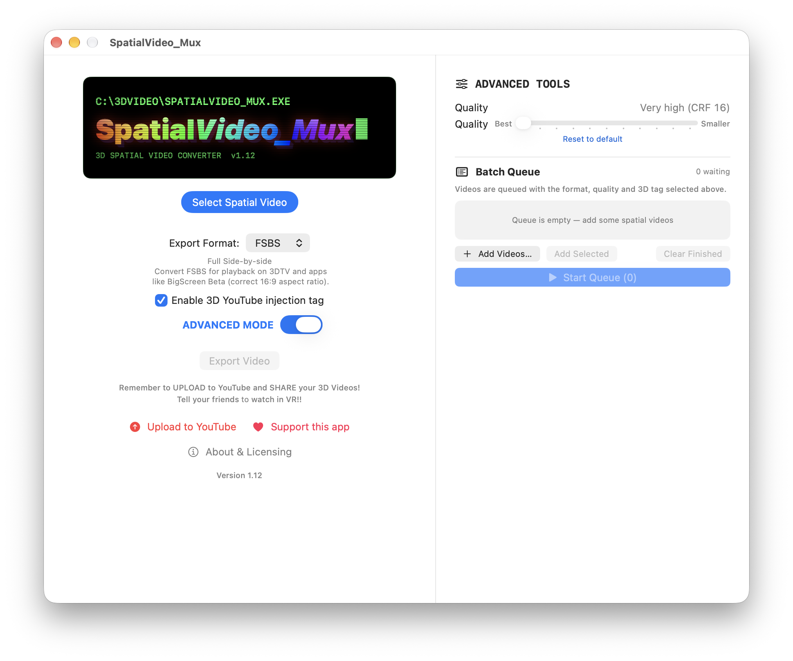

# SpatialVideo_Mux

Converts Apple **spatial (MV‑HEVC) videos**, like those shot on iPhone 15 Pro, iPhone 16 and later (Apple Vision Pro untested), into **3D side‑by‑side** MP4s ready for **YouTube 3D**, VR headsets and 3D TVs.




It extracts the left and right eye views, lays them side by side, tags the stream (the flag YouTube uses to detect 3D), and copies the original audio.

Available for **macOS** (Apple Silicon) and **Windows 11**.

## Download

Get the latest version from the **[Releases page](https://github.com/sebsebsebbo/SpatialVideo_Mux/releases/latest)**.

| Your computer | Download this file |
|---|---|
| Mac with Apple Silicon (M1 or later), macOS 15 or later | `SpatialVideo_Mux-v1.12-macOS-arm64.zip` |
| Windows 11 PC (64-bit) | `SpatialVideo_Mux-v1.12-Windows-x64.zip` |

Only macOS 15 / 26 and Windows 11 have been tested.

## Install

### macOS
1. Unzip the download.
2. Move **SpatialVideo_Mux** to your **Applications** folder.
3. Open it. The app is **notarized by Apple**, so it opens normally. If macOS still asks, right‑click the app → **Open** → **Open** (you only need to do this once).

### Windows
1. Unzip the download into a folder (keep all the files together).
2. Run **SpatialVideo_Mux.exe**.

## Formats

| Option | Per‑eye size | Output | Use |
|---|---|---|---|
| **3D HSBS** | 960×1080 | 3840×1080 full side‑by‑side | Best for YouTube upload for VR |
| **3D FSBS** | 1920×1080 | 1920×1080 half side‑by‑side | High Resolution video however currently plays squashed on YouTube 3D. Likely incompatible with many 3DTVs and other 3D hardware. |

## How to use

1. Click **Select Spatial Video** and choose a spatial video recorded on iPhone.
2. Click **PREVIEW VIDEO** if you want to check it first.
3. Pick **3D FSBS** or **3D HSBS**. The description changes depending on which you select.
4. Tick **Enable 3D YouTube injection tag** when uploading FSBS to YouTube for VR playback.
5. Click **Export Video** and choose where to save.
6. Upload the result to YouTube. It will be detected as 3D automatically.
7. Watch it in the YouTube VR app to see it in 3D.

### Advanced Mode
Flip the switch from **BASIC BITCH** to **ADVANCED MODE** and a tools panel opens on the right:

- **Quality slider** – choose between best quality and smaller files.
- **Batch Queue** – add lots of spatial videos, each with its own format and quality, then convert them all in one go. You get a notification when the whole batch is finished.

### Getting your videos onto your computer
- **Mac:** AirDrop spatial videos from your iPhone straight to your Mac.
- **Windows:** copy them over by USB cable or another safe transfer method.

## What's new

See the **[Releases page](https://github.com/sebsebsebbo/SpatialVideo_Mux/releases)** for the full history.

**v1.12**
- Updated the HSBS and FSBS descriptions in the app: HSBS is now recommended for YouTube VR (with the 3D tag), and FSBS for 3D TVs and apps like BigScreen Beta.

**v1.11**
- **Batch Queue** now shows the total time remaining for all videos, beneath the time for the current video.

**v1.1**
- New animated retro title screen, with a pop‑out **PREVIEW VIDEO** window.
- **Advanced Mode**: quality slider and **Batch Queue** with a notification when finished.
- Fixed the H.264 level for FSBS (3840×1080), so exports play more reliably on TVs and headsets.
- Better encoding quality and faster‑starting uploads.

## Repository layout

```
macos/        Xcode project for the macOS app
windows/      Source for the Windows app
docs/         Screenshots for this README
third_party/  FFmpeg / x264 licence text
```

Finished apps are **not** stored in the repository. They are attached to each release on the Releases page.

## Built with FFmpeg and x264

This app bundles and runs [FFmpeg](https://ffmpeg.org) as a **separate program**, launched at runtime as its own process to decode MV‑HEVC and encode the output. FFmpeg is not linked into the app, and its source is not part of the app's own code.

Huge thanks to the **x264 Project and the FFmpeg development team**. Without their work this app would not be possible. 🙏

## License

**SpatialVideo_Mux is proprietary software.** Copyright © 2026 Sebastian Gonzalez Agero. The source code is published here to read, but may not be copied, modified or redistributed without permission. See [LICENSE](LICENSE).

The bundled **FFmpeg** and **x264** are licensed separately under the **GNU General Public License v3.0** (see [third_party/LICENSE-FFmpeg](third_party/LICENSE-FFmpeg)).

- The x264 Project: https://www.videolan.org/developers/x264.html – Copyright (C) 2003‑2026 x264 project.
- The FFmpeg Project: https://ffmpeg.org – Copyright (c) 2000‑2026 the FFmpeg project.

The corresponding source code for the bundled GPL components is available at:

- x264: https://code.videolan.org/videolan/x264
- FFmpeg: https://github.com/FFmpeg/FFmpeg/tree/n9.0

---

With thanks to the FFmpeg and x264 projects for their software, to my partner Matt for suffering through this, and to Claude for helping me persevere and work on this idea.
